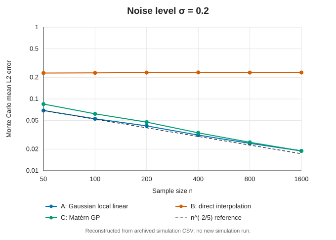
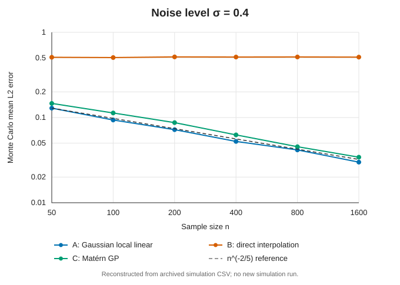

# Matérn coefficient estimation (Method C)

Independent extension of the original ode-coefficient-simulation. No existing files are changed.

## Model and methods
- True ODE: x'(t) = 0.8 (x(t)^2 + t), x(0) = 0.4.
- Data: Y_i = x(t_i) + sigma epsilon_i, independent standard normal errors.
- A: original Gaussian local linear smoother with bandwidth 0.48 n^(-1/5), then square and add t.
- B: original direct substitution and linear interpolation.
- C: zero-mean GP with fixed covariance K(s,t) = (1+r+r^2/3) exp(-r), r = |s-t|. Known noise variance sigma^2. Solve (C_n + sigma^2 I) alpha = y; x_hat(t) = k_n(t)^T alpha; B_hat(t) = x_hat(t)^2 + t. No hyperparameter fitting.

Same grids, sample sizes, seed (2026), RNG draw order, 300 replications and Simpson quadrature as the original. A/B mean errors reproduce the original stored CSV to displayed precision. All three methods share the observations in each replication.

## Run
Install numpy, scipy, pandas and matplotlib in your Python environment. From this folder run `python simulation.py`. The script writes a CSV and two log-log PNG plots into results/. The CSV includes Monte Carlo standard errors (MCSEs) and the paired C-minus-A MCSE, alongside fitted exponents.

## Results
| sigma | A exponent | B exponent | C exponent | A error at n=1600 | C error at n=1600 |
| --- | ---: | ---: | ---: | ---: | ---: |
| 0.2 | 0.3769 | -0.0047 | 0.4372 | 0.018861 | 0.018865 |
| 0.4 | 0.4138 | -0.0027 | 0.4260 | 0.029953 | 0.034225 |

Method C shows decreasing mean L2 error, but does not outperform A in mean error over the tested grid. This is empirical evidence, not proof of consistency or an asymptotic rate. The kernel scale is fixed at the original MAGI convention, not tuned to this example.

## Archived plots

These SVG plots were reconstructed directly from the archived numerical CSV (log-log axes and the original reference slope). They are not the original PNG binaries. Running `python simulation.py` recreates the PNG plots and CSV using the documented seed and settings.
